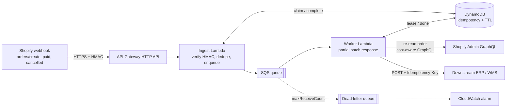

# shopify-order-relay

A serverless TypeScript reference implementation for the integration work Shopify agencies are most often asked to build: **get orders out of Shopify and into another system (ERP, WMS, 3PL, accounting) reliably.**

It is a small, complete pipeline, not a framework. Every piece of reliability logic is isolated, injectable and unit tested offline.

## The problem it solves

A merchant says "send every new order to our warehouse system". The naive version (a route that parses JSON and calls the other API) fails in production in predictable ways:

| Failure | What happens naively | What this repo does |
|---|---|---|
| Forged or garbled request | Anyone can POST fake orders | HMAC-SHA256 on the raw body, constant-time compare |
| Shopify retries a delivery (it does, for up to ~4h) | Duplicate shipments or invoices | Two-level idempotency (delivery id at the edge, lease+done record in the worker, `Idempotency-Key` downstream) |
| Downstream system is down | Orders silently lost, or Shopify gives up and deletes the subscription after 8 consecutive failures | Ack fast, queue, retry, DLQ with evidence |
| Slow downstream call | Webhook exceeds the 5 s limit and counts as failed | Ingest does no business logic |
| Burst of orders (sale day) | GraphQL `THROTTLED` errors, dropped enrichment calls | Cost-aware client paces itself against the leaky bucket |

## Architecture



Code map:

- `src/ingest/handler.ts` - verify, dedupe, enqueue, answer in milliseconds
- `src/worker/` - SQS consumer (partial batch failures), payload mapping, optional Admin API re-read
- `src/shopify/graphql-client.ts` - throttle-aware GraphQL client
- `src/idempotency/` - store interface, in-memory (tests) and DynamoDB (deployed) implementations
- `src/destination/http.ts` - downstream POST with transient/permanent error classification
- `src/lambda.ts` - environment wiring only
- `test/` - offline tests with signed webhook fixtures

## Run locally

Requires Node 20+. No Shopify store or AWS account needed for the checks below.

```bash
npm install
npm run check      # typecheck + lint + tests
npm run build      # emits dist/
```

To exercise the handlers by hand, import `createIngestHandler` with the in-memory store and queue (see `test/ingest.test.ts`) and feed it an event built with `webhookEvent()` from `test/helpers.ts`. `.env.example` lists what the deployed functions read.

## Local demo (no AWS, no Shopify)

This is a local demo only. Nothing is deployed and nothing leaves your machine. It runs the real ingest and worker handlers against in-memory stand-ins for SQS and DynamoDB (`src/demo/`), plus a mock downstream that can be told to fail. The stand-ins model visibility-delay retries, receive counts and a DLQ, not real SQS/DynamoDB behaviour, so it shows the logic, not AWS semantics.

```bash
npm run demo:scenario   # one command: starts everything, runs the scripted tour, prints the trace, exits
```

Or run the server and drive it yourself:

```bash
npm run demo:local      # terminal 1: http://127.0.0.1:8787/webhooks/shopify (PORT, HOST, SHOPIFY_API_SECRET override)
npm run demo:send       # terminal 2: signed sample webhooks
```

The tour sends a valid signed order (ACCEPTED, DELIVERED), a tampered body (REJECTED 401), a repeated delivery id (DEDUPED), then makes the downstream return 500 twice and hang once so you see RETRY with backoff and a single delivery per order. A real captured run is in [docs/demo-output.txt](docs/demo-output.txt).

Hand-made requests (default demo secret shown):

```bash
SECRET=demo-shopify-client-secret
BODY=$(cat test/fixtures/orders-create.json)
SIG=$(printf '%s' "$BODY" | openssl dgst -sha256 -hmac "$SECRET" -binary | base64)
curl -i -X POST http://127.0.0.1:8787/webhooks/shopify \
  -H "Content-Type: application/json" -H "X-Shopify-Hmac-SHA256: $SIG" \
  -H "X-Shopify-Webhook-Id: curl-1" -H "X-Shopify-Topic: orders/create" \
  -H "X-Shopify-Shop-Domain: dev-store.myshopify.com" --data-binary "$BODY"
# make the downstream fail the next 2 requests, then resend with a new Webhook-Id
curl -X POST http://127.0.0.1:8787/control/downstream -d '{"mode":"500","times":2}'   # or "timeout", "ok"
```

### Pointing a real Shopify dev store at it later

1. Start the server with your app's client secret: `SHOPIFY_API_SECRET=<client secret> npm run demo:local` (shell env only, never commit it).
2. Expose it with a tunnel you trust, for example `cloudflared tunnel --url http://127.0.0.1:8787` or `ngrok http 8787`.
3. In the dev store create an `orders/create` webhook (Settings, Notifications, Webhooks, or the Admin API) with URL `https://<tunnel-host>/webhooks/shopify`.
4. Place a test order and watch the trace. The worker uses the webhook payload (it does not call the Admin API in the demo). This path has not been exercised against a real store; see Status.

## Deploy (described, not provided)

No IaC is included on purpose; agencies have their own (CDK, SAM, Terraform, SST). The resources needed:

1. **DynamoDB table**, partition key `pk` (string), TTL attribute `expiresAt`, on-demand billing.
2. **SQS queue** with a **DLQ** (`maxReceiveCount` around 5) and a visibility timeout of at least 6x the worker timeout.
3. **Ingest Lambda** (`dist/lambda.ingest`) behind an API Gateway HTTP API route `POST /webhooks/shopify`. Env: `SHOPIFY_API_SECRET`, `IDEMPOTENCY_TABLE`, `ORDER_QUEUE_URL`. IAM: `dynamodb:PutItem/UpdateItem/DeleteItem` on the table, `sqs:SendMessage` on the queue.
4. **Worker Lambda** (`dist/lambda.worker`) with an SQS event source mapping and **`ReportBatchItemFailures` enabled** (without it the whole batch is retried). Env as above plus `DESTINATION_URL`, `DESTINATION_TOKEN`, `SHOPIFY_ADMIN_TOKEN`, `SHOPIFY_API_VERSION`. Keep batch size small (5-10) and reserved concurrency low to protect the downstream system and the GraphQL bucket.
5. **Alarm** on DLQ depth > 0 and on ingest 5xx rate.
6. **Subscribe** to `orders/create`, `orders/paid`, `orders/cancelled` with the callback URL, either in the app's `shopify.app.toml` or via the `webhookSubscriptionCreate` mutation.

Secrets belong in SSM Parameter Store or Secrets Manager, resolved at cold start, not in plain Lambda environment variables.

## Design decisions and trade-offs

- **Ack fast, process later.** Shopify allows a 1 s connect and 5 s total response time, and wants 200 OK. Ingest only verifies, dedupes and enqueues. Cost: one more hop, and ordering is not guaranteed.
- **Dedupe on `X-Shopify-Webhook-Id`, not `X-Shopify-Event-Id`.** The webhook id is unique per delivery; the event id is shared by every subscription to the same merchant action. Dedupe on the former; the latter is only carried for correlation.
- **Lease + done, not a bare "seen" flag.** A flag set before the work loses the order if the worker crashes; a flag set after allows concurrent double processing. A short lease taken first, marked done after, and released on failure handles both. A crashed worker's lease just expires.
- **Exactly-once is not claimed.** The guarantee is at-least-once delivery with effectively-once effects. One window remains: the downstream call succeeds, then `complete()` fails. The retry then re-sends, which is why the downstream call carries a deterministic `Idempotency-Key`. A downstream system that ignores that header needs its own dedupe (e.g. on order id).
- **Re-read the order from the Admin API.** A retried webhook can be hours old. Fetching current state costs a few GraphQL points and avoids sending stale data. The webhook-only path is kept for when you do not want the dependency.
- **Cost-aware GraphQL client rather than a fixed delay.** It extrapolates the bucket from `extensions.cost.throttleStatus` (`currentlyAvailable`, `restoreRate`) and sleeps only when the next query would not fit. `THROTTLED` errors arrive inside HTTP 200 responses, so status codes alone are not enough. For large historical backfills use bulk operations instead; this client is for per-event calls.
- **Permanent vs transient errors.** The destination client and GraphQL client classify failures. Permanent ones (bad payload, 4xx) are logged distinctly but still returned as batch failures so the evidence lands in the DLQ rather than vanishing. A sturdier version would write them to a separate "poison" queue and ack the original.
- **Full-jitter backoff** for 5xx/network errors to avoid retry synchronisation across concurrent Lambdas.
- **Dependencies injected, no framework.** `fetch`, clock, sleep, randomness, store and queue are all parameters, which is what makes the tests fast and deterministic.
- **Single-shop token in env.** Fine for a custom app for one merchant. A public multi-tenant app needs OAuth, per-shop encrypted offline tokens and the mandatory GDPR webhooks; that is deliberately out of scope here.

## Security notes

- Signature verification uses the raw body bytes (base64-decoded when API Gateway flags the body as such) and `crypto.timingSafeEqual`. Verification runs before any parsing or lookup.
- Unsigned or mis-signed requests get 401 and are never enqueued or logged beyond a warning.
- Logs never include payload bodies, customer email or tokens.
- After an app secret rotation Shopify may take up to an hour to switch signing keys; consider accepting two secrets during rotation.
- Least-privilege IAM per function (listed above). The Admin API token needs only `read_orders`.
- `.env` is git-ignored; `.env.example` contains placeholders only.
- Not implemented: replay-window checks (Shopify gives no signed timestamp, so the delivery-id dedupe is the defence), IP allow-listing, request size limits beyond API Gateway defaults.

## Status (what has and has not been run)

Verified, offline:

- `npm run typecheck` (TypeScript strict, `noUncheckedIndexedAccess`, `exactOptionalPropertyTypes`), `npm run lint` and `npm test` (45 tests, 10 of them for the local demo wiring) pass locally. CI runs the same plus a build.
- Tests cover HMAC accept/reject cases, ingest status codes and duplicate handling, the worker's lease/retry/partial-failure behaviour, GraphQL throttling, 429 and 5xx handling, and the DynamoDB command shapes.

**Not verified:**

- **Never run against a real Shopify store.** All Shopify behaviour is mocked. Header names, HMAC scheme, `extensions.cost` shape and the `THROTTLED` code were checked against Shopify's documentation, but real deliveries have not been received. The `X-Shopify-Topic`, `X-Shopify-Shop-Domain` and `X-Shopify-API-Version` header names come from Shopify's delivery documentation and general knowledge and have not been confirmed against a live delivery.
- **Never deployed to AWS.** `src/lambda.ts`, the DynamoDB conditional-write semantics (tested only against a stub of the SDK client) and SQS partial batch behaviour are unverified against real services.
- The GraphQL order query has not been validated against the live schema for the pinned API version (`2026-10`). Run it through GraphiQL or the Admin API before relying on it.
- No load testing, so the throttling heuristics are untested under real contention from multiple concurrent Lambdas (each keeps its own bucket estimate; a shared limiter would be needed at high concurrency).

To demo it live you would need a free Shopify Partner development store, an app or custom app with `read_orders`, a tunnel or an AWS account for the endpoint, and a request-catcher URL as the downstream system.

## Licence

MIT
